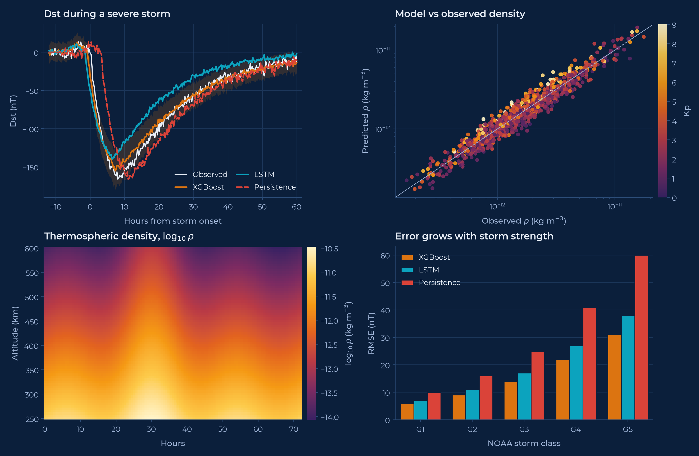
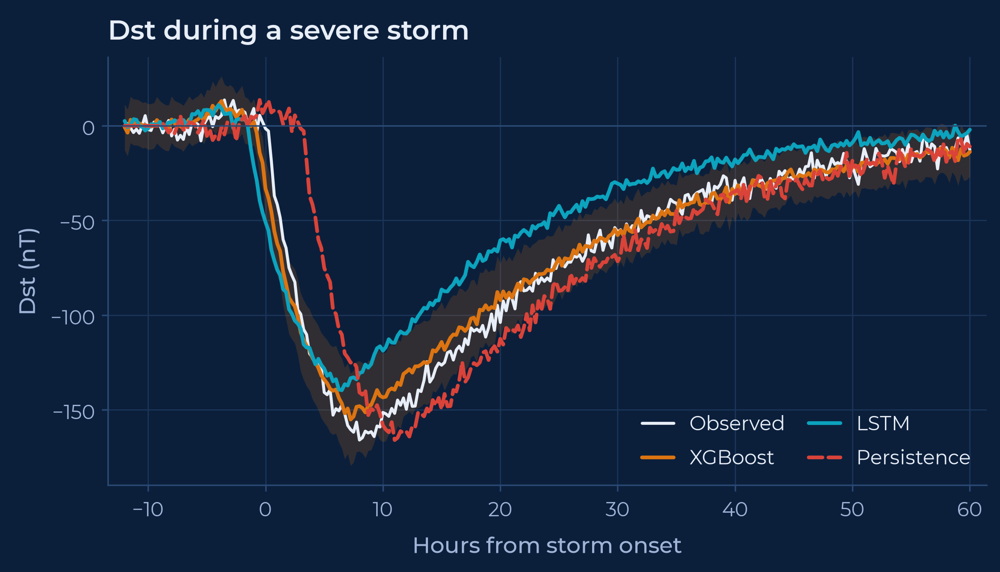
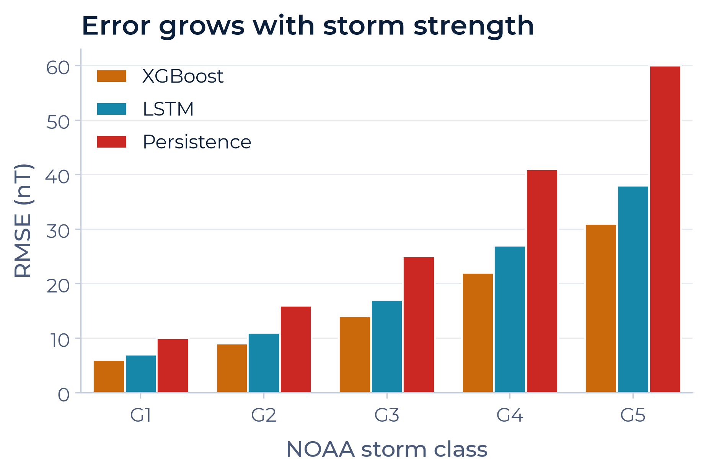
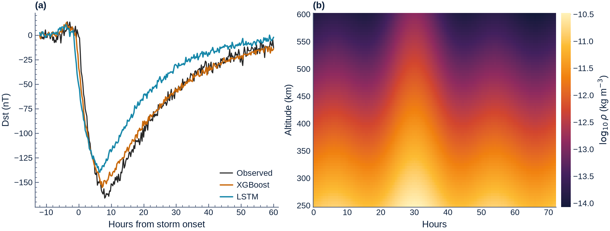
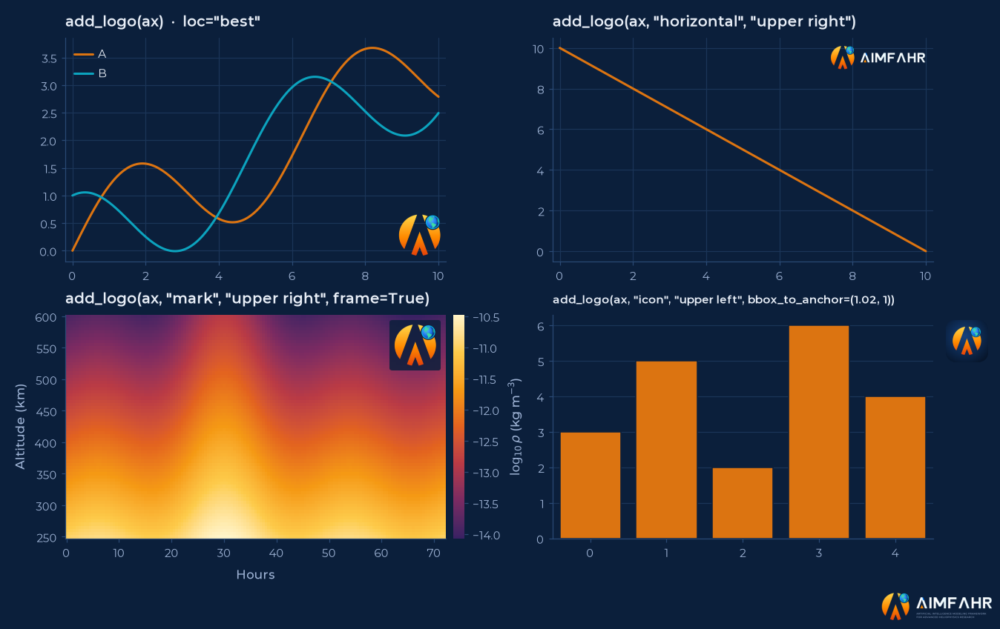
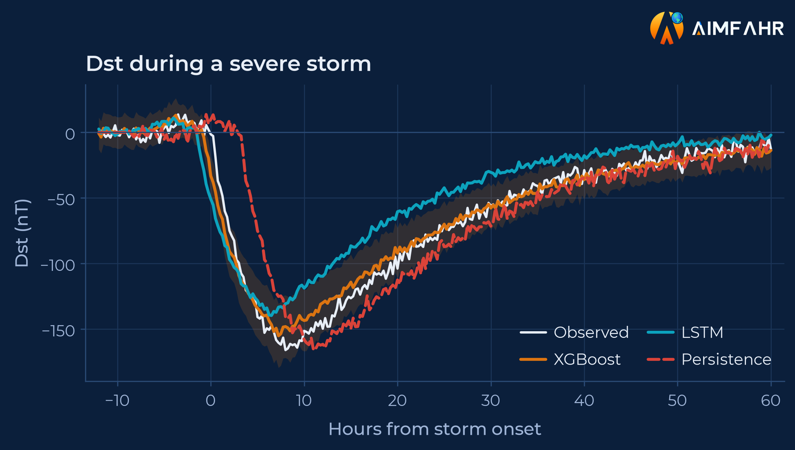
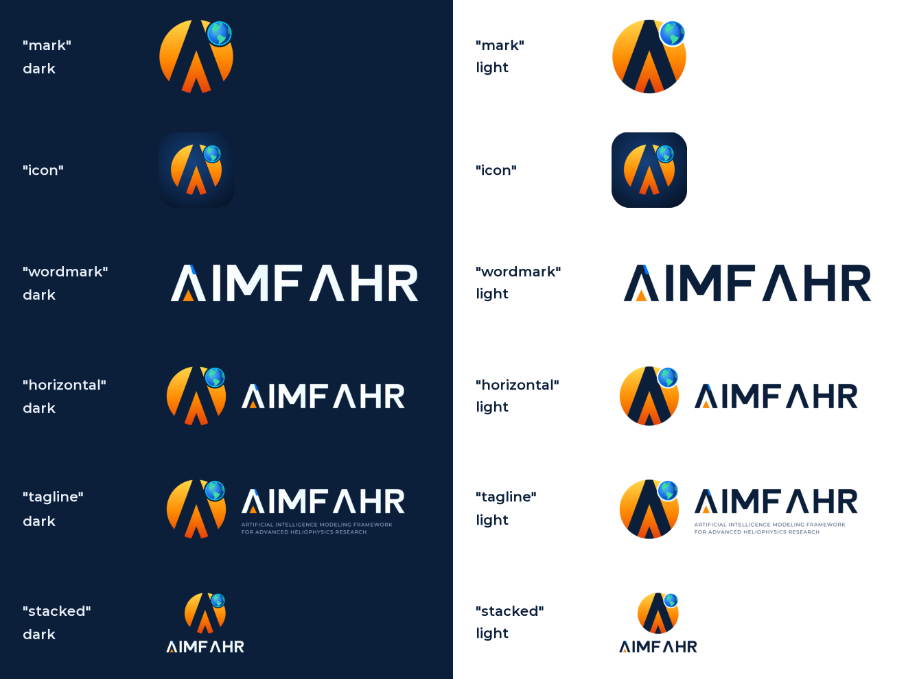
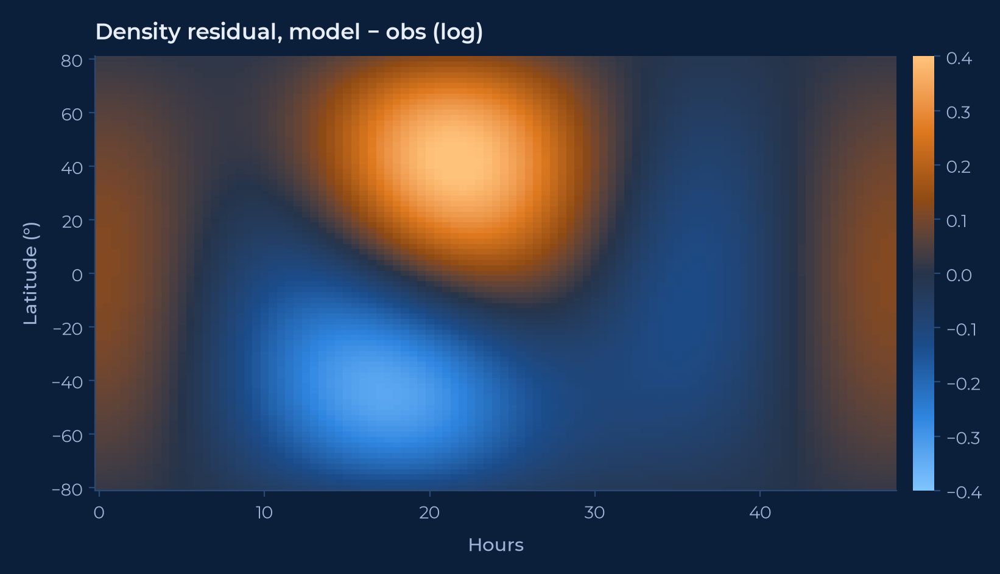
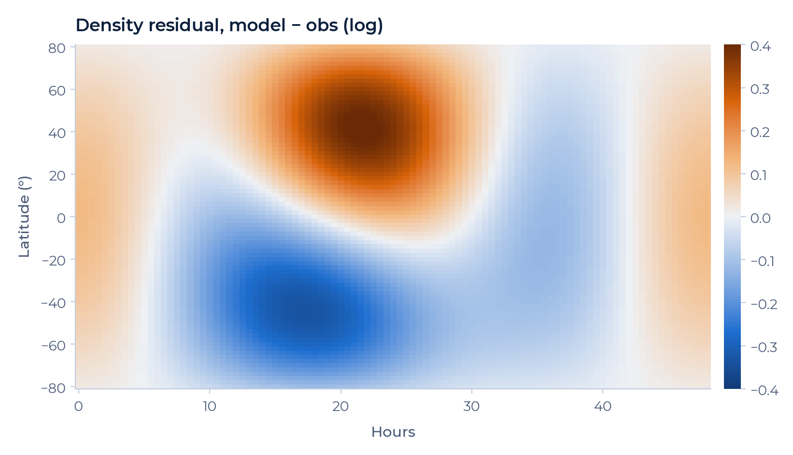

# aimfahr-mpl

Matplotlib styles and logos for **AIMFAHR**, the Artificial Intelligence Modeling Framework for Advanced Heliophysics Research.

You pick a **theme** (the background) and a **context** (where the figure is going), and optionally add a **logo**.



## Contents

1. [Install](#1-install)
2. [Load a style](#2-load-a-style)
3. [Themes and contexts](#3-themes-and-contexts)
4. [Journal figures](#4-journal-figures)
5. [Add a logo](#5-add-a-logo)
6. [All logos](#6-all-logos)
7. [Colours and colormaps](#7-colours-and-colormaps)
8. [Reference](#8-reference)
9. [Repository layout and development](#9-repository-layout-and-development)

## 1. Install

From GitHub:

```bash
pip install git+https://github.com/kylermurphy/aimfahr-mpl
```

Or from a clone:

```bash
git clone https://github.com/kylermurphy/aimfahr-mpl
cd aimfahr-mpl
pip install .            # normal install
pip install -e ".[test]" # editable, with pytest, if you'll change the styles
```

Requires Python 3.9+, matplotlib 3.7+ and numpy. The Montserrat font is bundled (SIL Open Font License), so nothing else needs installing.

Check it works:

```bash
python -c "import aimfahr_mpl; print(aimfahr_mpl.__version__)"
```

## 2. Load a style

The simplest way is one call:

```python
import matplotlib.pyplot as plt
import aimfahr_mpl

aimfahr_mpl.use("dark", "slides")     # theme, context

fig, ax = plt.subplots()
ax.plot(t, dst, label="Observed")
ax.set(xlabel="Hours from storm onset", ylabel="Dst (nT)", title="Dst during a severe storm")
ax.legend()
fig.savefig("dst.png")
```

`use()` applies two style sheets, registers Montserrat and the AIMFAHR colormaps, and sets the default colormap for the theme.

The style sheets are ordinary matplotlib styles, so these also work once the package has been imported:

```python
plt.style.use(["aimfahr_mpl.light", "aimfahr_mpl.web"])

with plt.style.context(["aimfahr_mpl.dark", "aimfahr_mpl.poster"]):
    ...   # only inside this block
```

If you use the sheets without `import aimfahr_mpl`, text falls back to Inter, Helvetica or Arial, and the default colormap is `inferno` (dark) or `viridis` (light).

## 3. Themes and contexts

| Theme | Background | Use |
| --- | --- | --- |
| `dark` | Navy `#0B1F3B` | Web, slides and posters on the brand background |
| `light` | White | Light slide templates, documents, printed posters, journals |

| Context | Figure size | Base font | Use |
| --- | --- | --- | --- |
| `web` | 8 × 4.5 in | 11 pt | Websites, notebooks, docs |
| `slides` | 11 × 6.2 in | 18 pt | 16:9 presentations |
| `poster` | 12 × 8 in | 28 pt | Posters, read from 1–2 m |
| `journal` | 3.5 × 2.6 in | 8 pt | Journal articles (see section 4) |

Line widths, markers, ticks and spacing scale with the context. Any theme works with any context, but `journal` is designed for `light`.

| Slides, dark | Poster, light |
| --- | --- |
|  |  |

## 4. Journal figures

```python
aimfahr_mpl.use("light", "journal")

fig, (a1, a2) = plt.subplots(1, 2, figsize=aimfahr_mpl.journal_size("double", aspect=0.38))
...
fig.savefig("figure2.pdf")
```

The journal context follows common author guidelines rather than the brand look:

- Arial or Helvetica (Liberation Sans or DejaVu Sans if neither is installed), 7–8 pt.
- No grid, inward ticks with minor ticks, darker axes for print.
- Saves PDF at 600 dpi with fonts embedded as editable TrueType (`pdf.fonttype 42`).
- Keeps the brand colour cycle, which is colour-blind checked.

`journal_size(width, aspect)` returns a figure size in inches:

| `width` | Inches | mm |
| --- | --- | --- |
| `"single"` | 3.5 | 89 |
| `"onehalf"` | 5.5 | 140 |
| `"double"` | 7.2 | 183 |
| a number | that many inches | |

`aspect` is height divided by width: 0.75 for one panel, about 0.35–0.45 for a row of panels. Check your journal's exact widths and pass them as a number if they differ.



## 5. Add a logo

`add_logo()` places a logo the way `legend()` places a legend: same location names, `loc="best"`, `bbox_to_anchor` and dragging.

```python
aimfahr_mpl.add_logo(ax)                                   # mark, best free spot in ax
aimfahr_mpl.add_logo(ax, "horizontal", "upper right")      # a lockup in a corner
aimfahr_mpl.add_logo(ax, "mark", "upper right", frame=True)  # backed box, for heatmaps
aimfahr_mpl.add_logo(ax, "icon", "upper left", bbox_to_anchor=(1.02, 1))  # outside the axes
aimfahr_mpl.add_logo(fig, "tagline")                       # figure corner, space reserved
```



**Where it goes**

- **On an axes** (`add_logo(ax, ...)`): any legend location, `"upper left"`, `"center right"`, and so on. `"best"` (the default) picks the corner or edge with the least overlap with lines, points, bars, text, and any legend or logo already on the axes. Matplotlib's own `"best"` ignores other legends, so this one is a small improvement.
- **On a figure** (`add_logo(fig, ...)`): use `"outside ..."` locations, e.g. `"outside lower right"` (the default) or `"outside upper right"`. Constrained layout then shrinks the plots to make room, so the logo never covers data. Without `outside`, the logo sits on top of whatever is in that corner.
- **Exact positions:** `loc=(x, y)` puts the logo's lower-left corner at that axes-fraction position. Or combine `loc` with `bbox_to_anchor`, exactly as for legends.

**Size and colour**

- `height` sets the logo height in points. The default scales with the context font size, so a logo looks in proportion on a web plot, a slide and a poster without changes.
- `theme="auto"` picks the dark or light version from the background colour. Force it with `theme="dark"` or `"light"`.
- `alpha` makes the logo translucent, e.g. `alpha=0.6` for a watermark.
- `frame=True` draws a rounded box in the axes colour behind the logo, which keeps it readable over images and heatmaps.

**Interactive use and removal**

`add_logo` returns the logo object (a `Legend` subclass). Use `draggable=True`, or call `.set_draggable(True)` later, to move it with the mouse in an interactive window. Call `.remove()` to take it off.

```python
logo = aimfahr_mpl.add_logo(ax, draggable=True)
logo.remove()
```

**What it reuses**

Matplotlib already places images by legend location codes (`OffsetImage` with `AnchoredOffsetbox`), but only legends implement `loc="best"`, and that search is private. So the logo is drawn *as* a one-entry legend with a custom handler. That reuses matplotlib's placement exactly, including `"best"`, `bbox_to_anchor`, `"outside"` figure locations and dragging. The logos are high-resolution PNGs, so PDF and SVG output embed a raster image.

**Slides with a figure-corner logo**

```python
aimfahr_mpl.use("dark", "slides")
fig, ax = plt.subplots()
...
aimfahr_mpl.add_logo(fig, "horizontal", "outside upper right")
```



## 6. All logos

| Name | Use |
| --- | --- |
| `"mark"` | The sun-and-A symbol. Default; fits most plots. |
| `"icon"` | The mark on a navy tile. Works on any background. |
| `"wordmark"` | The name only. |
| `"horizontal"` | Mark and name side by side. Best for slide and figure corners. |
| `"tagline"` | Horizontal plus the full name. Use large, e.g. posters and title slides. |
| `"stacked"` | Mark above the name. For tall or square spaces. |

Every logo except `"icon"` has a dark-background and a light-background version. `add_logo` picks the right one automatically.



To use a logo file directly, for example in a slide deck:

```python
aimfahr_mpl.logo_path("horizontal", "dark")   # -> Path to the PNG
aimfahr_mpl.LOGOS                             # all names
```

Vector originals (SVG) of every logo, plus the brand colours and usage rules, are in [`brand/`](brand/). They are kept in the repository but not installed with the package.

## 7. Colours and colormaps

**Colour cycle.** Eight brand hues in a fixed order: orange, cyan, red, blue, green, violet, gold, pink. Each theme has its own values, tuned for its background and checked for colour-blind separation between neighbours and 3:1 contrast. Give each model or dataset the same colour in every figure (`color="C0"`), and don't re-sort colours by value. For more than eight series, group the extras or use small multiples.

```python
aimfahr_mpl.CYCLE["dark"], aimfahr_mpl.CYCLE["light"]   # hex lists
aimfahr_mpl.COLORS                                      # brand colours: navy, sun, earth, cyan, ...
```

**Colormaps.** All are interpolated in OKLab, so lightness changes evenly. Each has a `_r` reverse.

| Name | Kind | Use |
| --- | --- | --- |
| `aimfahr_sun` | Sequential | Magnitudes (density, flux, power). Default for `light`. |
| `aimfahr_sun_dark` | Sequential | The same ramp starting brighter, so low values stay visible on navy. Default for `dark`. |
| `aimfahr_ice` | Sequential | A second magnitude beside the sun ramp. |
| `aimfahr_div` | Diverging | Signed values (residuals, anomalies) on white. |
| `aimfahr_div_dark` | Diverging | Signed values on navy. |

Centre diverging maps with `vmin=-a, vmax=a` or `matplotlib.colors.TwoSlopeNorm`.

| Diverging, dark | Diverging, light |
| --- | --- |
|  |  |

**Tip.** On navy, a translucent orange band looks brownish. Shade uncertainty with cyan (`color="C1"`) on the dark theme.

## 8. Reference

| Function | Does |
| --- | --- |
| `use(theme, context, *extra)` | Apply a theme and context. `extra` style sheets are applied after and win. |
| `add_logo(target, logo, loc, ...)` | Add a logo to an axes or figure. See section 5. |
| `logo_path(name, theme)` | Path of a bundled logo PNG. |
| `journal_size(width, aspect)` | Figure size for journal columns. |
| `direct_labels(ax)` | Write each line's label at its right end, in the text colour. Good for four lines or fewer. |
| `colormaps()` | Dict of the AIMFAHR colormaps. |

| Constant | Holds |
| --- | --- |
| `THEMES`, `CONTEXTS`, `LOGOS` | Valid names |
| `CYCLE` | Colour cycle per theme |
| `COLORS` | Brand colours |

## 9. Repository layout and development

```
aimfahr-mpl/
├── src/aimfahr_mpl/      # the installable package
│   ├── __init__.py       # use(), colours, colormaps, journal_size()
│   ├── logo.py           # add_logo(), logo_path()
│   ├── *.mplstyle        # dark, light, web, slides, poster, journal
│   ├── fonts/            # Montserrat + OFL licence
│   └── logos/            # PNG logos used by add_logo()
├── brand/                # SVG logos and brand rules (not installed)
├── examples/gallery.py   # renders docs/gallery/
├── docs/gallery/         # images used in this README
├── tests/                # pytest suite
└── .github/workflows/    # runs the tests on push and pull requests
```

The style sheets sit at the package root on purpose: `plt.style.use("aimfahr_mpl.dark")` only finds `.mplstyle` files placed directly in the package.

Run the tests:

```bash
pip install -e ".[test]"
pytest
```

Rebuild the README images with `python examples/gallery.py`. The data in it is synthetic.

## License

Code: MIT (see [LICENSE](LICENSE)). Montserrat: SIL Open Font License 1.1. The AIMFAHR logos identify the project and are not covered by the MIT license.
